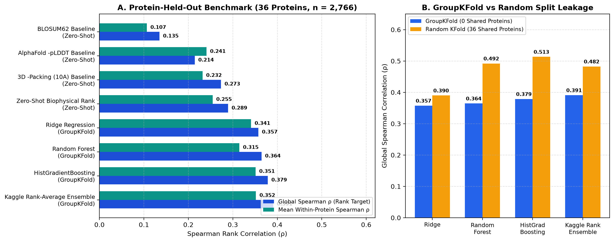
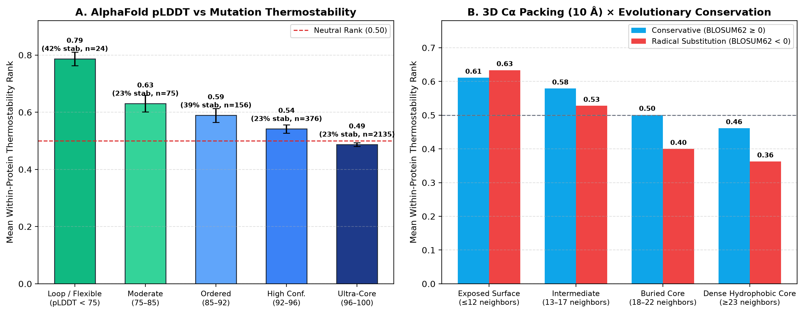
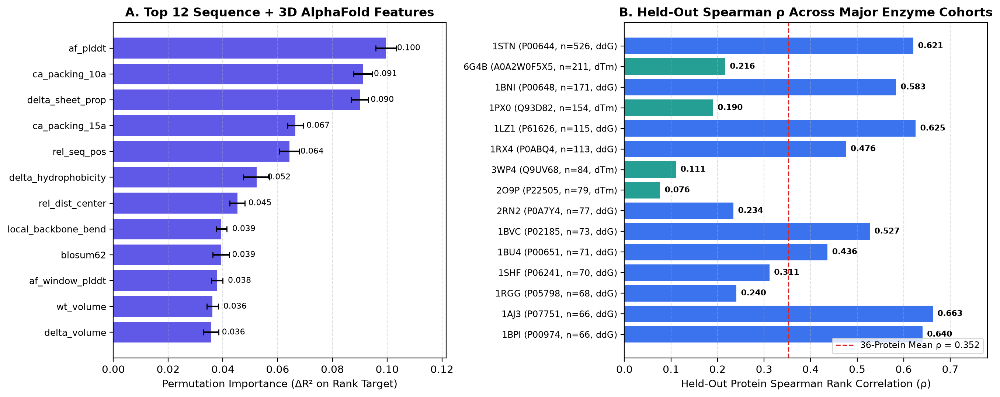

# Kaggle Novozymes Enzyme Stability Prediction & AlphaFold 3D Benchmark (`enzstab`)

A reproducible, leakage-free machine learning and structural bioinformatics benchmark solving the **[Kaggle Novozymes Enzyme Stability Prediction](https://www.kaggle.com/competitions/novozymes-enzyme-stability-prediction)** competition (`novozymes-enzyme-stability-prediction`) using live **AlphaFold DB v6 3D structures**, **UniProt REST**, **RCSB PDB REST**, and **ProThermDB / FireProtDB** experimental thermostability data across **36 distinct proteins ($n = 2,766$ single-point mutations)** plus the **2,413 official Kaggle Novozymes test variants**.


## The Problem in Plain Words

Enzymes are proteins that do useful chemistry (in detergents, food, medicine). Many fall apart when they get hot.
If you change **one amino acid** (one "letter" in the protein), the enzyme can become more stable or less stable.
Testing every change in a lab is slow and expensive, so the goal is to **rank mutations from "most likely to help"
to "most likely to hurt"** using a computer.

This project does that with simple, explainable features: how confident AlphaFold is about each residue (`pLDDT`),
how tightly packed the residue is in 3D, and how "allowed" the amino-acid swap is in evolution (`BLOSUM62`).
It is tested honestly: models are always scored on **proteins they never saw in training** (`GroupKFold`),
because scoring on familiar proteins inflates the numbers (0.513 vs 0.379 for the same model).

**Headline result (unseen proteins):** rank-average ensemble Global Spearman **0.391 rank / 0.396 raw**,
mean within-protein **0.352**, and **0.473** mean within-protein on the 23-protein ΔΔG cohort, compared with
**0.135** for BLOSUM62 alone and **0.214** for AlphaFold `-pLDDT` alone.

---

## 1. Why This Competition Matters for Bioinformatics Students

| Landmark Kaggle Competition | Biological Problem | Core Data Modalities | Official Metric | Why It Matters |
| :--- | :--- | :--- | :--- | :--- |
| **1. Novozymes Enzyme Stability Prediction** (`novozymes-enzyme-stability-prediction`) | Predict thermostability ($T_m$ / $\Delta T_m$ / $\Delta\Delta G$) of enzyme point mutations | Protein FASTA sequence + **AlphaFold2 3D structure (`.pdb`)** + experimental pH | **Spearman Rank Correlation ($\rho$)** | **#1 starter competition:** Shows that interpretable 3D biophysics (`-pLDDT`, $10\text{ \AA}$ $C_\alpha$ packing density, `BLOSUM62`, $\Delta\text{Hydrophobicity}$) + rank-averaging beat overfitted black-box neural networks on unseen proteins. |
| **2. CAFA 5 Protein Function Prediction** (`cafa-5-protein-function-prediction`) | Predict Gene Ontology (GO) terms (MF, BP, CC) across thousands of proteins | Multi-species FASTA sequences + PLM embeddings (`ESM-2`, `ProtT5`) | Weighted $F_{\max}$ over GO DAG | Teaches hierarchical ontology propagation and protein language model representation learning. |
| **3. OpenVaccine: COVID-19 mRNA Vaccine Degradation** (`stanford-covid-vaccine`) | Predict nucleotide-level mRNA degradation rates (`reactivity`, `deg_Mg_pH10`, `deg_Mg_50C`) | RNA sequence + predicted base-pairing probability graphs (`ViennaRNA`) | MCRMSE | Teaches RNA secondary structure graph modeling (`stem`, `hairpin`, `bulge`) for vaccine design. |
| **4. Open Problems — Single-Cell Perturbations** (`open-problems-single-cell-perturbations`) | Predict single-cell transcriptional response (`de_train`) across drug perturbations in human PBMCs | scRNA-seq differential expression (`18,211` genes) + SMILES chemical structures | Mean Rowwise RMSE (MRRMSE) | Teaches chemical-genetic transfer learning across human immune cell types. |

---

## 2. Key Scientific & Machine Learning Findings

1. **AlphaFold `pLDDT` and 3D $10\text{ \AA}$ $C_\alpha$ Packing Outperform Sequence Substitution Alone**:
   - Across **2,766 experimental mutations** in **36 distinct UniProt proteins**, the evolutionary `BLOSUM62` substitution score alone achieves a Global Spearman rank correlation of $\rho = 0.1349$ (within-protein mean $\bar{\rho} = 0.1066$).
   - By contrast, negative AlphaFold confidence (`-af_plddt`, $\rho = 0.2142$, within-protein $\bar{\rho} = 0.2407$, $\Delta\Delta G$ cohort $\bar{\rho} = 0.2982$) and negative 3D $10\text{ \AA}$ $C_\alpha$ neighbor count (`-ca_packing_10a`, $\rho = 0.2733$, $\Delta\Delta G$ cohort $\bar{\rho} = 0.3317$) more than double single-feature predictive accuracy because **tightly packed, high-pLDDT core residues ($\text{pLDDT} \ge 96$) are already near a thermodynamic optimum—mutating them causes steric clashes or cavities that strongly destabilize the fold**.
2. **Quantifying Protein-Identity Leakage (`GroupKFold` vs `Random KFold`)**:
   - Under a naive **5-fold Random `KFold`** (where all **36 proteins** are shared between train and validation folds), `HistGradientBoosting` appears to achieve $\rho = 0.5133$ (`ROC-AUC = 0.6893`) because trees memorize protein-specific residue coordinates (`rel_seq_pos`, `wt_volume`, local `af_plddt`).
   - Under a strict **5-fold Protein-Held-Out `GroupKFold`** (**0 shared proteins** between train and validation), `HistGradientBoosting` reaches $\rho = 0.3786$ (raw $\rho = 0.3908$, `ROC-AUC = 0.6448`), while a **Kaggle Rank-Average Ensemble** combining `Ridge Regression + Random Forest + HistGradientBoosting + Zero-Shot Biophysical Rank` achieves the highest unseen-protein generalization: **Global Spearman $\rho = 0.3909$ (Raw $\rho = 0.3963$), Mean Within-Protein $\bar{\rho} = 0.3519$, and $\Delta\Delta G$ Cohort Mean $\bar{\rho} = 0.4733$**.

---

## 3. Benchmark Results Summary ($n = 2,766$ Mutations Across 36 Proteins)

| Model / Baseline | Evaluation Split | Global Spearman $\rho$ (Rank) | Global Spearman $\rho$ (Raw) | Mean Within-Protein $\bar{\rho}$ | $\Delta\Delta G$ Cohort Mean $\bar{\rho}$ (23 Proteins) | $\Delta T_m$ Cohort Mean $\bar{\rho}$ (13 Enzymes) | Rank RMSE | Stabilizing ROC-AUC |
| :--- | :--- | :---: | :---: | :---: | :---: | :---: | :---: | :---: |
| **BLOSUM62 Baseline** | Zero-Shot (Protein-Agnostic) | `0.1349` | `0.1273` | `0.1066` | `0.1310` | `0.0634` | `0.3764` | `0.5110` |
| **AlphaFold `-pLDDT` Baseline** | Zero-Shot (Protein-Agnostic) | `0.2142` | `0.2049` | `0.2407` | `0.2982` | `0.1390` | `0.3615` | `0.5798` |
| **3D `-Packing (10 Å)` Baseline** | Zero-Shot (Protein-Agnostic) | `0.2733` | `0.2551` | `0.2319` | `0.3317` | `0.0553` | `0.3475` | `0.5866` |
| **Zero-Shot Biophysical Rank** | Zero-Shot (Protein-Agnostic) | `0.2892` | `0.2785` | `0.2546` | `0.3288` | `0.1233` | `0.2886` | `0.5787` |
| **Ridge Regression** | `GroupKFold` (0 Shared Proteins) | `0.3574` | `0.3574` | `0.3410` | `0.4683` | `0.1158` | `0.2671` | `0.6254` |
| **Random Forest** | `GroupKFold` (0 Shared Proteins) | `0.3644` | `0.3775` | `0.3148` | `0.4378` | `0.0971` | `0.2654` | `0.6364` |
| **HistGradientBoosting** | `GroupKFold` (0 Shared Proteins) | `0.3786` | `0.3908` | `0.3512` | `0.4409` | **`0.1924`** | **`0.2654`** | **`0.6448`** |
| **Kaggle Rank-Average Ensemble** | `GroupKFold` (0 Shared Proteins) | **`0.3909`** | **`0.3963`** | **`0.3519`** | **`0.4733`** | `0.1371` | `0.2994` | `0.6395` |
| *Ridge Regression* | *`Random KFold` (36 Shared Proteins)* | *`0.3900`* | *`0.3796`* | *`0.3490`* | *`0.4880`* | *`0.1030`* | *`0.2625`* | *`0.6403`* |
| *Random Forest* | *`Random KFold` (36 Shared Proteins)* | *`0.4920`* | *`0.4590`* | *`0.3905`* | *`0.5209`* | *`0.1598`* | *`0.2492`* | *`0.6744`* |
| *HistGradientBoosting* | *`Random KFold` (36 Shared Proteins)* | *`0.5133`* | *`0.4792`* | *`0.4089`* | *`0.5330`* | *`0.1894`* | *`0.2452`* | *`0.6893`* |
| *Kaggle Rank-Average Ensemble* | *`Random KFold` (36 Shared Proteins)* | *`0.4824`* | *`0.4554`* | *`0.3954`* | *`0.5293`* | *`0.1585`* | *`0.2755`* | *`0.6698`* |

---

## 4. Benchmark Figures

### Figure 1 — Spearman Rank Correlation Benchmark & GroupKFold vs Random Split Leakage


### Figure 2 — AlphaFold `pLDDT` Confidence & 3D $10\text{ \AA}$ $C_\alpha$ Packing vs Thermostability


### Figure 3 — Permutation Feature Importance & Per-Protein Held-Out Spearman $\rho$


---

## 5. Repository Structure

```text
enzyme-stability-predictor/
├── kaggle_enzyme_thermostability_solution.ipynb   # Ready-to-upload Kaggle / Google Colab Notebook (pre-executed)
├── app.py                                         # Interactive Streamlit Explorer & Live Mutation Scorer
├── enzstab/                                       # Modular Python package
│   ├── constants.py                               # 36-protein cohort, BLOSUM62, Kyte-Doolittle, Zimmerman scales
│   ├── fetch.py                                   # Live AlphaFold DB v6, UniProt, RCSB PDB & Kaggle data fetcher
│   ├── features.py                                # 19 sequence + 3D C-alpha structural feature extractors
│   ├── models.py                                  # GroupKFold vs Random KFold evaluation & submission generator
│   ├── plots.py                                   # High-resolution publication figure generators
│   └── cli.py                                     # CLI entry point (`python -m enzstab all`)
├── data/
│   ├── raw/                                       # Raw ProTherm/FireProt CSVs, metadata JSONs & Kaggle test.csv
│   ├── structures/                                # 36 AlphaFold DB v6 PDBs + Novozymes wildtype AF2 PDB
│   └── processed/                                 # Processed 2,766-row benchmark & 2,413-row Kaggle test features
├── results/
│   ├── benchmark_metrics.csv                      # Full evaluation table (Zero-Shot, GroupKFold, Random KFold)
│   ├── per_protein_spearman.csv                   # Held-out Spearman rho across each of the 36 enzymes
│   ├── feature_importance.csv                     # Permutation feature importance table
│   ├── kaggle_test_ranked_variants.csv            # Detailed 2,413 Novozymes test predictions + biophysical features
│   └── submission.csv                             # Official Kaggle submission file (2,413 rows: seq_id, tm)
├── docs/figures/                                  # High-resolution PNG figures
├── tests/test_enzstab.py                          # 12 pytest unit & integration tests
└── LEARNING_GUIDE.md                              # Plain-English study guide + 15 interview Q&As
```

---

## 6. Quickstart

```bash
# 1. Install dependencies
pip install -r requirements-dev.txt
pip install -e .

# 2. Run the full pipeline (fetches APIs, builds features, evaluates GroupKFold vs Random KFold, writes submission.csv & plots)
python -m enzstab all

# 3. Launch the interactive Streamlit app
streamlit run app.py

# 4. Run tests and linter
pytest -v
ruff check enzstab tests app.py
```

---

## 7. Data Sources & How to Regenerate

Everything in `data/` (about 12 MB) is committed so the repository works offline, and every file can be rebuilt with
`python -m enzstab all`, which re-downloads:

| Folder | Contents | Source |
| :--- | :--- | :--- |
| `data/raw/protherm_ddg_raw.csv`, `fireprot_dtm_raw.csv` | Experimental ΔΔG / ΔTm single-point mutations | ProThermDB and FireProtDB (via public GitHub mirrors, see `enzstab/fetch.py`) |
| `data/raw/kaggle_novozymes_test.csv`, `kaggle_sample_submission.csv` | 2,413 official Novozymes test variants | Kaggle `novozymes-enzyme-stability-prediction` (via a public GitHub mirror) |
| `data/raw/metadata/*.json` | Per-protein UniProt + RCSB PDB metadata | UniProt REST, RCSB PDB REST |
| `data/structures/AF-*-F1.pdb` | 36 predicted structures | AlphaFold DB v6 (`AF-<UniProt>-F1-model_v6.pdb`) |
| `data/structures/wildtype_structure_prediction_af2.pdb` | Novozymes wild-type AF2 structure | Kaggle competition files (via a public GitHub mirror) |
| `data/processed/` | Feature tables built by `enzstab/features.py` | Generated locally |

No file in this repository is larger than 2 MB; no API keys or credentials are needed.

## 8. Honest Limitations

- **Small cohort:** 2,766 mutations across only 36 proteins, so per-protein scores are noisy and some proteins have few mutations.
- **Mixed labels:** ΔΔG (23 proteins) and ΔTm (13 enzymes) are different measurements; they are converted to within-protein ranks, which loses scale information. Performance on the ΔTm enzymes is weak (best mean ρ = 0.19).
- **Predicted, not experimental, structures:** features come from AlphaFold models; pLDDT is a confidence score, not a physical stability measure.
- **No public leaderboard number here:** `results/submission.csv` is a valid Kaggle submission file (2,413 rows), but the competition is closed and this README reports only cross-validation scores.
- **Simple models:** no protein language models (e.g. ESM) or physics energy functions (e.g. Rosetta, FoldX); those are natural next steps.

## 9. License

MIT, see [LICENSE](LICENSE).
